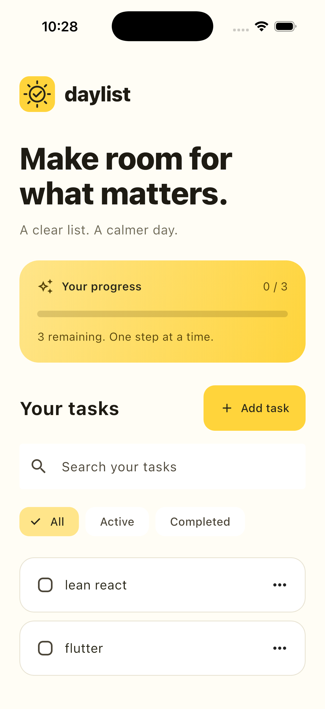

# Daylist

A calm, local-first Flutter task manager. Keep a clear list, see your progress,
and take the day one task at a time. No account or backend required.

<p align="center">
  
</p>

[Desktop preview](docs/daylist-desktop.png) · [Web mobile preview](docs/daylist-mobile.png)

## Open source

Released under the [MIT license](LICENSE). Contributions are welcome:
see [CONTRIBUTING.md](CONTRIBUTING.md). To upload your own copy, follow
[the GitHub publishing guide](docs/PUBLISHING.md).

GitHub Actions checks formatting, analysis, tests and a release web build on
pushes and pull requests.

## Features

- Create, edit, complete and delete tasks (with deletion confirmation).
- Search tasks and filter by active or completed status.
- Track completion progress.
- Restore tasks after restarting the app using shared_preferences.
- Show recoverable storage errors without replacing saved data.

The interface is in English; task names support Unicode, including Arabic.
Data stays on the current device/browser. Clearing app or browser data removes it.

## Run

Requires Flutter 3.44+ with Dart 3.12+.

```sh
flutter pub get
flutter run -d chrome
```

For an installed mobile device or emulator, use `flutter devices` and
`flutter run -d <device-id>`. Native builds require the platform toolchain.

## Verify

```sh
dart analyze lib test
flutter test
flutter build web
```

The tests cover task validation, creation, editing, completion, filtering,
search, deletion confirmation, persisted state, corrupt saved data, Unicode,
and a narrow mobile viewport.

If `flutter analyze` crashes in its LSP transport with this project's Unicode
folder path, use `dart analyze lib test` directly.

## Serve the release build

```sh
python3 -m http.server 8080 --bind 127.0.0.1 --directory build/web
```

Open http://127.0.0.1:8080. Web release output is in `build/web`.

## Project structure

- `lib/screens/home.dart` — responsive interface and task interactions.
- `lib/models/task.dart` — task model and serialization.
- `lib/services/task_store.dart` — local persistence.
- `test/widget_test.dart` — behavior, storage and mobile layout checks.

## Validation and limitations

Validated locally with Flutter 3.44.0: Dart analysis, five automated tests,
a release web build, and browser checks for creation, completion and reload.
Web is the verified target. Native platform folders are included but Android,
iOS and desktop builds have not been verified. Storage is local, unencrypted,
and does not sync between devices. The interface is currently English.

Third-party packages retain their respective licenses. The unused original
profile photo was removed; no third-party photography is bundled.
